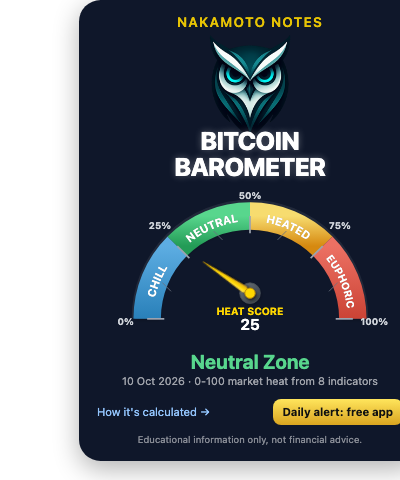

# Bitcoin Barometer: free Heat Score API and widget

The [NakamotoNotes Bitcoin Barometer](https://nakamotonotes.com/bitcoin-barometer) combines 8 Bitcoin indicators into one **Heat Score from 0 to 100** and a zone (Chill, Neutral, Heated, Euphoric). It shows where today's readings sit against their own history. It does not forecast price.

The on-chain inputs (MVRV-Z, NUPL, Puell Multiple) are computed from our own Bitcoin full node, with no on-chain data vendor involved. Method: [nakamotonotes.com/methodology](https://nakamotonotes.com/methodology).

Free to use. No key, no sign-up, HTTPS, CORS open.

## Endpoints

| Endpoint | Returns |
|---|---|
| `GET https://nakamotonotes.com/open/barometer.json` | current score, zone, time computed, three indicator readings, `degraded` list |
| `GET https://nakamotonotes.com/open/barometer-history.csv` | daily `date,score,zone` |

- Limit: 60 requests per minute per IP. Answers are cached for 5 minutes.
- If a reading cannot be produced, the API answers **503** instead of a number. It never sends a stale or made-up value.
- The history CSV is being rebuilt from our own node data. Until that finishes it returns 503.

Example response:

```json
{
  "score": 25,
  "heatScore": 0.254,
  "zone": "Neutral",
  "computedAt": "2026-10-10T08:08:04.608Z",
  "degraded": [],
  "indicators": { "monthlyRSI": 52.84, "mayerMultiple": "1.15", "piCycleProximity": 46.14 },
  "methodology": "https://nakamotonotes.com/methodology",
  "license": "CC BY 4.0 — attribute NakamotoNotes"
}
```

## Quick start

```bash
curl -s https://nakamotonotes.com/open/barometer.json
```

More in [`examples/`](examples): [curl](examples/curl.sh), [Python](examples/barometer.py), [JavaScript](examples/barometer.mjs).

## Embed the widget

Paste one line where the widget should appear:

```html
<script src="https://nakamotonotes.com/open/embed.js"></script>
```



## License

- **Data** (feed and CSV): [CC BY 4.0](https://creativecommons.org/licenses/by/4.0/). Attribute "NakamotoNotes" and link to https://nakamotonotes.com/bitcoin-barometer.
- **Code in this repository**: MIT, see [LICENSE](LICENSE).

## Not financial advice

The Barometer is educational information. It is not a recommendation to buy, sell or hold anything. Bitcoin is volatile; you can lose money.

Daily readings and push alerts when the zone changes are in the free [NakamotoNotes app](https://nakamotonotes.com/mobile-app?utm_source=github).
